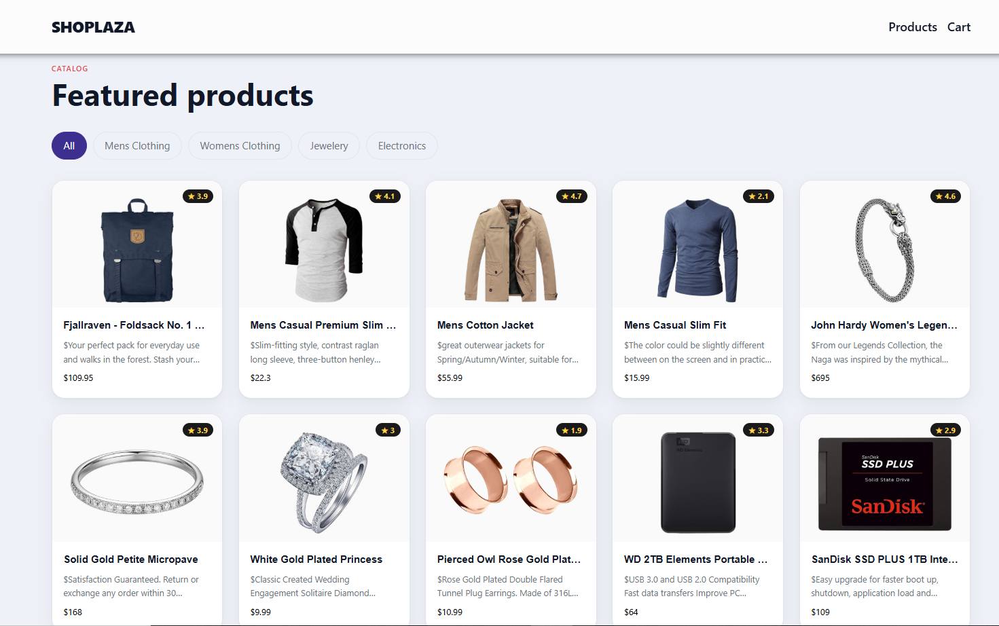
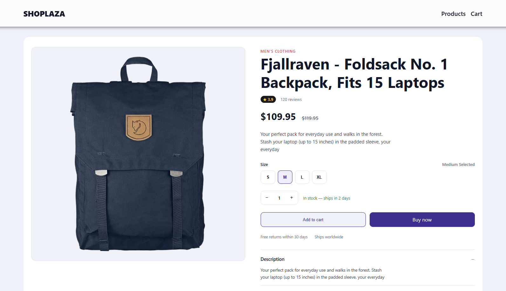
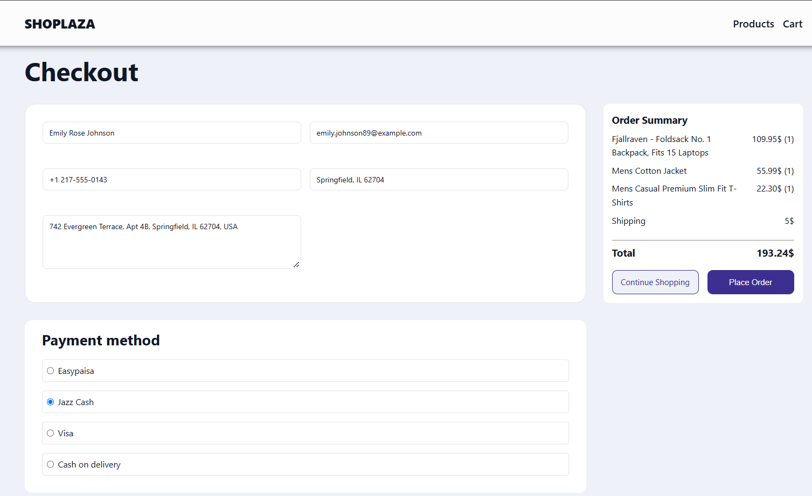

# 🛍️ React E-Commerce Store

A responsive e-commerce frontend built with **React, Vite, and JavaScript**, featuring product browsing, category filtering, cart management, and a simulated checkout.

## 🌐 Live Demo

**[View Live Demo](YOUR_LIVE_DEMO_URL)**

## ✨ Features

* Fetch products from the [Fake Store API](https://fakestoreapi.com/)
* Browse categories and view product details
* Select product sizes where applicable
* Add, remove, and update cart items
* Manage quantities and calculate order totals
* Responsive UI with simulated checkout

## 🧰 Tech Stack

**React · JavaScript · React Router · Context API · useReducer · HTML5 · CSS3 · Vite · ESLint**

## 🧠 Key Highlights

* Reusable React components
* Shared state management using Context API
* Reducer-based cart operations
* Client-side routing
* Successful ESLint check and production build

## 🚀 Getting Started

**Prerequisites:** Node.js and npm.

```bash
git clone YOUR_GITHUB_REPOSITORY_URL
cd YOUR_PROJECT_FOLDER
npm install
npm run dev
```

Check code quality and create a production build:

```bash
npm run lint
npm run build
```

## 📸 Screenshots

### Project Overview


### Products Page



### Product Details



### Cart & Checkout



## 👨‍💻 Author

**Muhammad Abbas**

* GitHub: [muhdabbasworks](https://github.com/muhdabbasworks)
* LinkedIn: [muhammad-abbas-3a994a416](https://www.linkedin.com/in/muhammad-abbas-3a994a416)

## 📄 License

This project is licensed under the MIT License.

## ⚠️ Note

This is a frontend project. Checkout is simulated; real payments and backend order processing are not implemented.

---

**Built with React to practice modern frontend development.**
